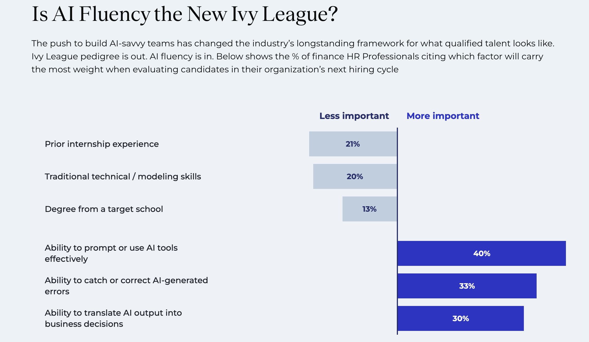
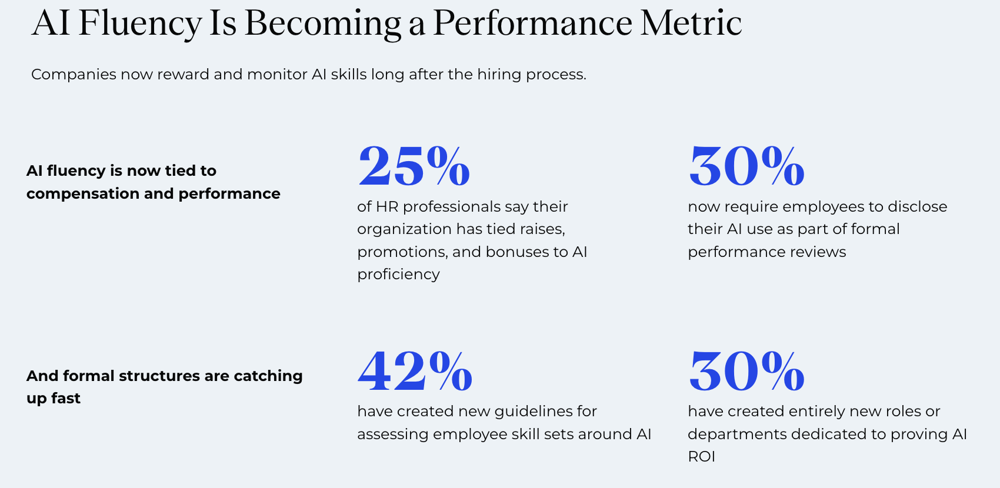
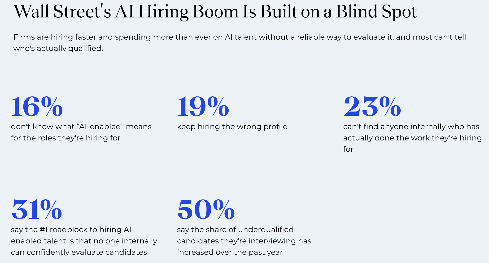

## The future of work

> If you work in finance doing spreadsheets, or you're in a call center, or you're an entry-level programmer — those jobs are definitely going to be changed and eliminated with at least this first inning of AI.

[Ford CEO Jim Farley, Accelerate the Essential Economy event, Detroit, reported by Fortune, July 2025]{.eyebrow}

## The future of work

> If you work in [finance doing spreadsheets]{style="color: #b8432f; font-weight: 700;"}, or you're in a call center, or you're an entry-level programmer — those jobs are definitely going to be [changed]{style="color: #b8432f; font-weight: 700;"} [and]{style="color: #b8432f; font-weight: 700;"} [eliminated]{style="color: #b8432f; font-weight: 700;"} with at least this first inning of AI.

[Ford CEO Jim Farley, Accelerate the Essential Economy event, Detroit, reported by Fortune, July 2025]{.eyebrow}

## The new job is managing AI agents {.band-bottom}

>
> You'll still have people at the top who are managing and have relationships with clients, but many, many of the processes underneath are now being done by AI systems.
>
> Workers would shift from being creators of reports or software updates, or 'makers' ... to 'checkers' or managers of AI agents doing that work.

[JP Morgan Chief Analytics Officer Derek Waldron, [CNBC interview, September 30, 2025](https://www.cnbc.com/2025/09/30/jpmorgan-chase-fully-ai-connected-megabank.html)]{.eyebrow}

## What AI can make

::: {.cards .cards-3}
::: {.card}
[Excel workbooks]{.card-title}
:::

::: {.card}
[PowerPoint decks]{.card-title}
:::

::: {.card}
[Word docs]{.card-title}
:::

::: {.card .card-blue}
[Charts]{.card-title}
:::

::: {.card .card-blue}
[Data analysis]{.card-title}

Merge, filter, aggregate, transform, statistics
:::

::: {.card .card-blue}
[Advanced data analysis]{.card-title}

Optimization, predictions (machine learning)
:::
:::

::: {.note .note-plum style="margin-top: 1.2em; font-size: 1.15em; font-weight: 700; color: #443f4c;"}
All from code or code + text.
:::

## {.no-title}

{height=430 fig-align="center"}

[[Selby Jennings: The AI Fluency Gap](https://www.selbyjennings.com/insights/ai-talent-pulse-report/). Research conducted by Censuswide, sample of 500 US HR Professionals in the finance industry in August, 2026.]{.eyebrow}

## {.no-title}

{height=430 fig-align="center"}

[[Selby Jennings: The AI Fluency Gap](https://www.selbyjennings.com/insights/ai-talent-pulse-report/). Research conducted by Censuswide, sample of 500 US HR Professionals in the finance industry in August, 2026.]{.eyebrow}

## AI fluency at Eccles

> At the David Eccles School of Business, an AI education vision set by Dean Kurt Dirks, that students are not only AI fluent but also fundamentally strong, is now being implemented.

[Callie Reed, [AI-Fluent Education at the Eccles School of Business](https://ai.utah.edu/blog/posts/2026/ai-fluent-education.php), University of Utah AI blog, January 23, 2026]{.eyebrow}

# What is AI fluency?

## Verifiable tasks vs judgment

::: {style="font-size: 0.85em;"}
> The gulf between LLM performance on verifiable tasks vs. unverifiable tasks that require judgement is larger than most people realize. Verifiable tasks, like coding or solving math problems, have a right answer that can be checked automatically. Judgement tasks — like how to respond to a customer complaint, how to organize data collection for your AI project, what product feature to add, or how to form business strategies — don't have unambiguous, ground-truth, correct answers. But they do have better and worse answers.
>
> We have much better techniques for training AI systems to do well on verifiable tasks. As a result, progress on performing such tasks has been much faster than for judgement tasks.
:::

[Andrew Ng, co-founder and former head of Google Brain, co-founder of Coursera and DeepLearning.AI · The Batch, October 16, 2026]{.eyebrow}

## AI cannot make the judgment calls

> Technology itself does not decide what the future looks like. People do. For all the promise of AI … AI cannot decide which problems are worth solving. It cannot make the hard judgment calls with imperfect information. It cannot take responsibility for the outcome. These are our responsibilities. And they matter more now than ever.

[AMD CEO Lisa Su, [MIT Commencement address](https://news.mit.edu/2026/commencement-address-lisa-su-0528), May 28, 2026]{.eyebrow}

## Human judgment at the core

> I need human judgment, I need human decision making, I need human accountability at the core.

[HSBC CEO Georges Elhedery, [Bloomberg TV interview](https://www.bloomberg.com/news/videos/2026-06-08/hsbc-ceo-says-bank-still-needs-human-judgment-in-ai-era-video), June 8, 2026]{.eyebrow}

## Not replacing judgment

> The goal is to remove the repetitive, administrative work so our people can focus on what they do best—we're not replacing critical thinking and judgment, we're removing the tedious, time-consuming work that gets in the way of it.

[Customers Bank CEO Sam Sidhu, statement to [Fortune](https://fortune.com/2026/04/28/ceo-of-customers-bank-sam-sidhu-ai-clone-lead-earnings-call-mark-zuckerberg-building-digital-twin/), April 28, 2026]{.eyebrow}

## What we teach in business schools

```{=html}
<svg viewBox="0 0 1080 440" style="width:953px; max-width:100%; display:block; margin:0 auto; font-family:inherit;" xmlns="http://www.w3.org/2000/svg">
<defs><marker id="arr" viewBox="0 0 10 10" refX="9" refY="5" markerWidth="7" markerHeight="7" orient="auto-start-reverse"><path d="M0,0 L10,5 L0,10 z" fill="#6f8497"/></marker></defs>
<rect x="0" y="10" width="470" height="66" fill="#EBEDEB"/><rect x="0" y="10" width="6" height="66" fill="#595460"/>
<text x="22" y="39" font-size="24" fill="#3b3842">How to run factories</text>
<text x="22" y="64" font-size="16" letter-spacing="1.5" fill="#6f6b77">OPERATIONS</text>
<rect x="0" y="95" width="470" height="66" fill="#EBEDEB"/><rect x="0" y="95" width="6" height="66" fill="#595460"/>
<text x="22" y="124" font-size="24" fill="#3b3842">How to get people to buy things</text>
<text x="22" y="149" font-size="16" letter-spacing="1.5" fill="#6f6b77">MARKETING</text>
<rect x="0" y="180" width="470" height="66" fill="#EBEDEB"/><rect x="0" y="180" width="6" height="66" fill="#595460"/>
<text x="22" y="209" font-size="24" fill="#3b3842">How to get people to invest in things</text>
<text x="22" y="234" font-size="16" letter-spacing="1.5" fill="#6f6b77">FINANCE</text>
<rect x="0" y="265" width="470" height="66" fill="#EBEDEB"/><rect x="0" y="265" width="6" height="66" fill="#595460"/>
<text x="22" y="294" font-size="24" fill="#3b3842">How to keep track of money in and out</text>
<text x="22" y="319" font-size="16" letter-spacing="1.5" fill="#6f6b77">ACCOUNTING</text>
<rect x="0" y="350" width="470" height="66" fill="#EBEDEB"/><rect x="0" y="350" width="6" height="66" fill="#595460"/>
<text x="22" y="379" font-size="24" fill="#3b3842">How to manage people</text>
<text x="22" y="404" font-size="16" letter-spacing="1.5" fill="#6f6b77">MANAGEMENT</text>
<g class="fragment" data-fragment-index="1">
<path d="M478,43.0 C580,43.0 580,190.0 684,190.0" fill="none" stroke="#6f8497" stroke-width="3" marker-end="url(#arr)"/>
<path d="M478,128.0 C580,128.0 580,190.0 684,190.0" fill="none" stroke="#6f8497" stroke-width="3" marker-end="url(#arr)"/>
<path d="M478,213.0 C580,213.0 580,190.0 684,190.0" fill="none" stroke="#6f8497" stroke-width="3" marker-end="url(#arr)"/>
<path d="M478,298.0 C580,298.0 580,190.0 684,190.0" fill="none" stroke="#6f8497" stroke-width="3" marker-end="url(#arr)"/>
<rect x="690" y="105" width="390" height="170" fill="#595460"/>
<text x="885.0" y="185" font-size="34" font-weight="700" fill="#ffffff" text-anchor="middle">Managing AI</text>
<text x="885.0" y="223" font-size="19" fill="#ffffff" text-anchor="middle">directing and checking AI</text>
<text x="885.0" y="248" font-size="19" fill="#ffffff" text-anchor="middle">that does the work</text>
</g>
<g class="fragment" data-fragment-index="2">
<path d="M478,383.0 L684,383.0" fill="none" stroke="#6f8497" stroke-width="3" marker-end="url(#arr)"/>
<rect x="690" y="333" width="390" height="100" fill="#97A7B8"/>
<text x="885.0" y="395.0" font-size="34" font-weight="700" fill="#3b3842" text-anchor="middle">Managing people</text>
</g>
</svg>
```

[Most of what we teach becomes managing: people, and now AI.]{.fragment data-fragment-index="3" style="display:block; margin-top:0.4em; font-weight:700; color:#443f4c;"}

## What's left for people

```{=html}
<svg viewBox="0 0 1080 330" style="width:953px; max-width:100%; display:block; margin:0 auto; font-family:inherit;" xmlns="http://www.w3.org/2000/svg">
<rect x="130" y="10" width="390" height="170" fill="#595460"/>
<text x="325.0" y="90" font-size="34" font-weight="700" fill="#ffffff" text-anchor="middle">Manage AI</text>
<text x="325.0" y="128" font-size="19" fill="#ffffff" text-anchor="middle">directing and checking AI</text>
<text x="325.0" y="153" font-size="19" fill="#ffffff" text-anchor="middle">that does the work</text>
<rect x="130" y="220" width="390" height="100" fill="#97A7B8"/>
<text x="325.0" y="282.0" font-size="34" font-weight="700" fill="#3b3842" text-anchor="middle">Manage people</text>
<rect x="560" y="10" width="390" height="170" fill="#EBEDEB"/><rect x="560" y="10" width="6" height="170" fill="#595460"/>
<text x="755.0" y="107.0" font-size="34" font-weight="700" fill="#595460" text-anchor="middle">Choose the problems</text>
<rect x="560" y="220" width="390" height="100" fill="#EBEDEB"/><rect x="560" y="220" width="6" height="100" fill="#595460"/>
<text x="755.0" y="282.0" font-size="34" font-weight="700" fill="#595460" text-anchor="middle">Make judgment calls</text>
</svg>
```

## {.no-title}

{height=430 fig-align="center"}

[[Selby Jennings: The AI Fluency Gap](https://www.selbyjennings.com/insights/ai-talent-pulse-report/). Research conducted by Censuswide, sample of 500 US HR Professionals in the finance industry in August, 2026.]{.eyebrow}

# Is it over-hyped?

## MIT NANDA: State of AI in Business 2025

> Tools like ChatGPT and Copilot are widely adopted. Over 80 percent of organizations have explored or piloted them, and nearly 40 percent report deployment. But these tools primarily enhance individual productivity, not P&L performance. Meanwhile, enterprise-grade systems, custom or vendor-sold, are being quietly rejected. Sixty percent of organizations evaluated such tools, but only 20 percent reached pilot stage and just 5 percent reached production.

[Challapally, Pease, Raskar and Chari, MIT NANDA, The GenAI Divide: State of AI in Business 2025, July 2025 · [Fortune coverage](https://fortune.com/2025/08/18/mit-report-95-percent-generative-ai-pilots-at-companies-failing-cfo/)]{.eyebrow}

## MIT NANDA: the shadow AI economy

::: {.stats}
::: {.stat}
[40%]{.stat-value}
[of companies bought an official LLM subscription]{.stat-label}
:::
::: {.stat}
[90%+]{.stat-value}
[of companies have workers who use personal AI tools for work]{.stat-label}
:::
:::

> While only 40% of companies say they purchased an official LLM subscription, workers from over 90% of the companies we surveyed reported regular use of personal AI tools for work tasks. In fact, almost every single person used an LLM in some form for their work.

[Challapally, Pease, Raskar and Chari, MIT NANDA, The GenAI Divide: State of AI in Business 2025, July 2025 · [Fortune coverage](https://fortune.com/2025/08/18/mit-report-95-percent-generative-ai-pilots-at-companies-failing-cfo/)]{.eyebrow}

## Enterprise adoption {.plain-title}

::: {.comparison-table}

| | Anthropic | OpenAI | Google | Open Source |
|---|---|---|---|---|
| **Enterprise LLM spend** (Menlo, Dec 2025) | [**40%**]{.amber} | 27% | 21% | 12% |
| **Company usage** (Datadog, Apr 2026) | ~46% (+23 pts YoY) | [**63%**]{.accent} of companies | ~37% (+20 pts YoY) | 13% of workloads |
| **Businesses paying** (Ramp, Aug 2026) | [**43.8%**]{.amber} | 39.8% | ? | 3.6% |
| **Code generation** (Menlo, Dec 2025) | [**54%**]{.amber} | 21% | ? | ? |

:::

::: {.footnote}
Anthropic is #1 by enterprise spend; OpenAI is #1 by breadth of adoption. The default enterprise strategy is [multi-model]{.accent} --- 69% of companies use 3+ models, routing different tasks to different providers. Closed-source models power 85--90% of enterprise workloads. The Ramp row is the share of 70,000+ US businesses paying each provider, and many pay more than one.
:::

## Limits to enterprise adoption {.compare .smaller}

:::: {.columns}
::: {.column width="50%"}
### Data security

> I can't risk client data mixing with someone else's model, even if the vendor says it's fine.

[Enterprise buyer interviewed for MIT NANDA, The GenAI Divide, July 2025]{.eyebrow}

59% of technology executives cite security and compliance concerns as top barriers to scaling AI agents.

[[IBM survey of 2,000 tech CxOs](https://newsroom.ibm.com/2026-06-08-new-ibm-study-finds-cios-and-ctos-face-growing-ai-control-gap-as-enterprise-deployment-scales), June 8, 2026]{.eyebrow}
:::

::: {.column width="50%"}
### Cost

> My token cost … is shooting through the roof. … Clients are ready to scale AI, but then they hit this unexpected cost wall.

[Lan Guan, Chief AI and Data Officer, Accenture, [Fortune](https://fortune.com/2026/07/29/cfo-hitting-cost-wall-ai-tokens-accenture/), July 29, 2026]{.eyebrow}

- Uber used up its 2026 AI budget by April, four months after rolling out Claude Code to engineers.
- Microsoft's Experiences + Devices group is moving engineers off Claude Code to GitHub Copilot CLI. Microsoft calls it "toolchain unification." Press reports point to cost.

[[Forbes](https://www.forbes.com/sites/janakirammsv/2026/05/17/uber-burns-its-2026-ai-budget-in-four-months-on-claude-code/), May 17, 2026, citing The Information · [The Next Web](https://thenextweb.com/news/microsoft-claude-code-retreat-ai-cost), May 25, 2026, citing Windows Central and The Verge]{.eyebrow}
:::
::::

## Predicted job losses are not showing up yet {.compare}

:::: {.columns}
::: {.column width="50%"}
[The prediction · May 2025]{.eyebrow}

Anthropic CEO Dario Amodei told Axios that AI could eliminate half of entry-level white-collar jobs and push unemployment to 10–20% within one to five years.
:::

::: {.column width="50%"}
[The data · 2026]{.eyebrow}

> Measures of AI usage show no connection to changes in employment or unemployment.

> The results do not yet show clear indication of labor market effects of AI.
:::
::::

[Yale Budget Lab, [Tracking the Impact of AI on the Labor Market](https://budgetlab.yale.edu/research/tracking-impact-ai-labor-market), updated October 14, 2026 · [AI Is Probably Not (Yet) the Reason for Labor Market Weakening](https://budgetlab.yale.edu/research/ai-probably-not-yet-reason-labor-market-weakening), May 7, 2026]{.eyebrow}

## A brief history {.band-bottom}

| When | What |
|----|--------------|
| 2017 | Google researchers publish the transformer ("Attention Is All You Need") |
| 2020 | GPT-3 (OpenAI) shows abilities that appear with scale |
| 2022--2023 | Online chatbots. You typed, it typed back |
| 2023--2024 | Code execution and web search arrive |
| 2025 | The serious versions move to the command line, reading and writing files on your own machine. DeepSeek R1 appears |
| 2025--2026 | That command-line capability is wrapped back into an app |
| 2026 | Agents that carry out extended work on your files without you living in a terminal |

## Andrej Karpathy: OpenAI co-founder, former Tesla AI chief, now at Anthropic {.smaller}

::: {.cards .cards-3}
::: {.card .fragment}
[October 2025]{.card-title}

"They just don't work. They don't have enough intelligence, they're not multimodal enough, they can't do computer use and all this stuff. They don't have continual learning. You can't just tell them something and they'll remember it."

"I feel like the industry is making too big of a jump and is trying to pretend like this is amazing, and it's not. It's slop."
:::

::: {.card .card-blue .fragment}
[December 2025]{.card-title}

"I really am mostly programming in English now, a bit sheepishly telling the LLM what code to write... in words. Biggest change to my basic coding workflow in ~2 decades."
:::

::: {.card .fragment}
[February 2026]{.card-title}

"It is hard to communicate how much programming has changed due to AI in the last 2 months: not gradually and over time in the 'progress as usual' way, but specifically this last December. Coding agents basically didn't work before December."

"I don't think I've typed like a line of code probably since December."
:::
:::
