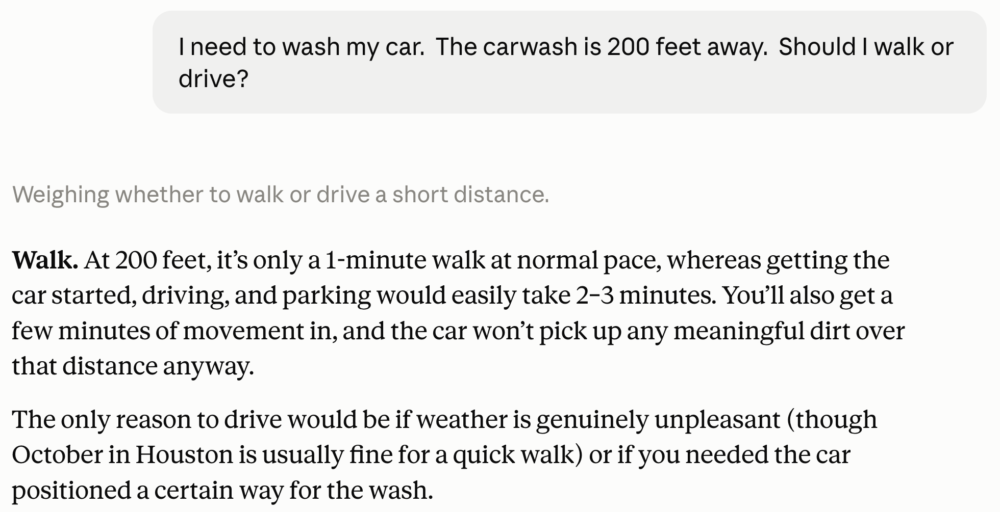
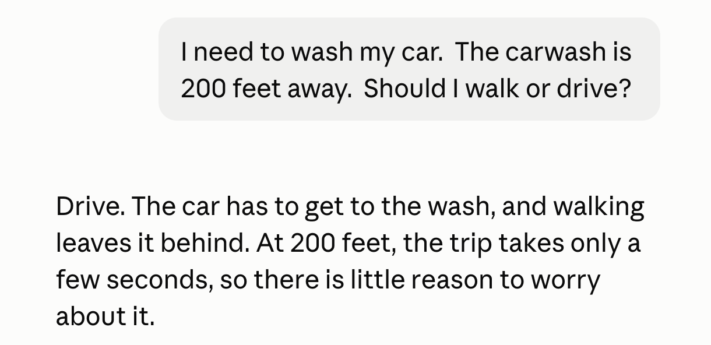
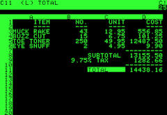

## The future of work

:::: {.columns}
::: {.column width="48%"}
> Artificial intelligence is going to replace [literally half of all white-collar workers]{.hl} in the U.S.
:::

::: {.column width="4%"}
:::

::: {.column width="48%"}
> If you work in [finance doing spreadsheets]{.hl}, or you're in a call center, or you're an entry-level programmer — those jobs are definitely going to be [changed and eliminated]{.hl} with at least this first inning of AI.
:::
::::

[Ford CEO Jim Farley. Left: Aspen Ideas Festival, June 2025. Right: Accelerate the Essential Economy event, Detroit, reported by Fortune, July 2025.]{.eyebrow}

## This is not your father's AI

::: {.cards .cards-3}
::: {.card}
[October 2025]{.card-title}

"They just don't work. They don't have enough intelligence ... I feel like the industry is making too big of a jump and is trying to pretend like this is amazing, and it's not. It's slop."
:::

::: {.card .card-blue .fragment}
[January 2026]{.card-title}

"I really am mostly programming in English now, a bit sheepishly telling the LLM what code to write... in words."
:::

::: {.card .fragment}
[February–March 2026]{.card-title}

"It is hard to communicate how much programming has changed due to AI in the last 2 months: not gradually and over time in the 'progress as usual' way, but specifically this last December. Coding agents basically didn't work before December ... I don't think I've typed like a line of code probably since December."
:::
:::

[Andrej Karpathy: OpenAI co-founder, former Tesla AI chief, now at Anthropic]{.eyebrow}

## Accelerating the pace of work {.pull}

> [Alfred] removed about 90% of the manual effort that once went into preparing our weekly financial review. We used to spend hundreds of hours preparing 100+ slides for a Monday meeting.

[Marie Myers, CFO, Hewlett Packard Enterprise, [Fortune](https://fortune.com/2026/02/12/hpe-cfo-used-ai-transform-100-slide-monday-meeting/), February 12, 2026]{.eyebrow}

## From makers to checkers {.title-left}

> You'll still have people at the top who are managing and have relationships with clients, but many, many of the processes underneath are now being done by AI systems.
>
> Workers would shift from being creators of reports or software updates, or 'makers' ... to 'checkers' or managers of AI agents doing that work.

[JP Morgan Chief Analytics Officer Derek Waldron, [CNBC interview, September 30, 2025](https://www.cnbc.com/2025/09/30/jpmorgan-chase-fully-ai-connected-megabank.html)]{.eyebrow}

## Not replacing critical thinking {.pull}

> The goal is to remove the repetitive, administrative work so our people can focus on what they do best—we're not replacing critical thinking and judgment, we're removing the tedious, time-consuming work that gets in the way of it.

[Customers Bank CEO Sam Sidhu, statement to [Fortune](https://fortune.com/2026/04/28/ceo-of-customers-bank-sam-sidhu-ai-clone-lead-earnings-call-mark-zuckerberg-building-digital-twin/), April 28, 2026]{.eyebrow}

## The future of work

```{=html}
<svg viewBox="0 0 1080 440" style="width:1150px; max-width:100%; display:block; margin:1em auto 0 auto; font-family:inherit;" xmlns="http://www.w3.org/2000/svg">
<rect x="130" y="10" width="390" height="145" fill="#36393B"/>
<text x="325" y="94" font-size="34" font-weight="700" fill="#ffffff" text-anchor="middle">Manage AI</text>
<rect x="560" y="10" width="390" height="145" fill="#3AEFCC"/>
<text x="755" y="94" font-size="34" font-weight="700" fill="#36393B" text-anchor="middle">Take initiative</text>
<rect x="130" y="175" width="390" height="145" fill="#3AEFCC"/>
<text x="325" y="259" font-size="34" font-weight="700" fill="#36393B" text-anchor="middle">Manage people</text>
<rect x="560" y="175" width="390" height="145" fill="#36393B"/>
<text x="755" y="259" font-size="34" font-weight="700" fill="#ffffff" text-anchor="middle">Make judgment calls</text>
<rect x="130" y="340" width="820" height="90" fill="#E7E4E6"/>
<text x="540" y="396" font-size="34" font-weight="700" fill="#36393B" text-anchor="middle">Customer, client, supplier relationships</text>
</svg>
```

::: {.note .fragment style="margin-top: 0.8em;"}
A lot of this is traditionally senior work. Juniors need to be prepared to step up.
:::

## AI fluency at Eccles {.pull .image-right}

::: {.image-panel}

[Photo: Jeff Hitchcock, CC BY 2.0]{.photo-credit}
:::

> At the David Eccles School of Business, an AI education vision set by Dean Kurt Dirks, that students are not only AI fluent but also fundamentally strong, is now being implemented.

[Callie Reed, [AI-Fluent Education at the Eccles School of Business](https://ai.utah.edu/blog/posts/2026/ai-fluent-education.php), University of Utah AI blog, January 23, 2026]{.eyebrow}

## Pillars of business-school education

```{=html}
<svg viewBox="0 0 1080 520" style="width:1000px; max-width:100%; display:block; margin:0.4em auto 0 auto; font-family:inherit;" xmlns="http://www.w3.org/2000/svg">
<polygon points="130,92 540,12 950,92" fill="#36393B"/>
<rect x="130" y="96" width="820" height="36" fill="#36393B"/>
<rect x="142" y="136" width="236" height="16" fill="#36393B"/>
<polygon points="142,152 378,152 360,172 160,172" fill="#36393B"/>
<rect x="160" y="172" width="200" height="274" fill="#E7E4E6"/>
<line x1="185" y1="182" x2="185" y2="242" stroke="#c9c5c8" stroke-width="5" stroke-linecap="round"/>
<line x1="185" y1="376" x2="185" y2="436" stroke="#c9c5c8" stroke-width="5" stroke-linecap="round"/>
<line x1="215" y1="182" x2="215" y2="242" stroke="#c9c5c8" stroke-width="5" stroke-linecap="round"/>
<line x1="215" y1="376" x2="215" y2="436" stroke="#c9c5c8" stroke-width="5" stroke-linecap="round"/>
<line x1="245" y1="182" x2="245" y2="242" stroke="#c9c5c8" stroke-width="5" stroke-linecap="round"/>
<line x1="245" y1="376" x2="245" y2="436" stroke="#c9c5c8" stroke-width="5" stroke-linecap="round"/>
<line x1="275" y1="182" x2="275" y2="242" stroke="#c9c5c8" stroke-width="5" stroke-linecap="round"/>
<line x1="275" y1="376" x2="275" y2="436" stroke="#c9c5c8" stroke-width="5" stroke-linecap="round"/>
<line x1="305" y1="182" x2="305" y2="242" stroke="#c9c5c8" stroke-width="5" stroke-linecap="round"/>
<line x1="305" y1="376" x2="305" y2="436" stroke="#c9c5c8" stroke-width="5" stroke-linecap="round"/>
<line x1="335" y1="182" x2="335" y2="242" stroke="#c9c5c8" stroke-width="5" stroke-linecap="round"/>
<line x1="335" y1="376" x2="335" y2="436" stroke="#c9c5c8" stroke-width="5" stroke-linecap="round"/>
<text x="260" y="300" font-size="30" font-weight="700" fill="#36393B" text-anchor="middle">AI</text>
<text x="260" y="338" font-size="30" font-weight="700" fill="#36393B" text-anchor="middle">fluency</text>
<rect x="142" y="446" width="236" height="16" fill="#36393B"/>
<rect x="422" y="136" width="236" height="16" fill="#36393B"/>
<polygon points="422,152 658,152 640,172 440,172" fill="#36393B"/>
<rect x="440" y="172" width="200" height="274" fill="#E7E4E6"/>
<line x1="465" y1="182" x2="465" y2="242" stroke="#c9c5c8" stroke-width="5" stroke-linecap="round"/>
<line x1="465" y1="376" x2="465" y2="436" stroke="#c9c5c8" stroke-width="5" stroke-linecap="round"/>
<line x1="495" y1="182" x2="495" y2="242" stroke="#c9c5c8" stroke-width="5" stroke-linecap="round"/>
<line x1="495" y1="376" x2="495" y2="436" stroke="#c9c5c8" stroke-width="5" stroke-linecap="round"/>
<line x1="525" y1="182" x2="525" y2="242" stroke="#c9c5c8" stroke-width="5" stroke-linecap="round"/>
<line x1="525" y1="376" x2="525" y2="436" stroke="#c9c5c8" stroke-width="5" stroke-linecap="round"/>
<line x1="555" y1="182" x2="555" y2="242" stroke="#c9c5c8" stroke-width="5" stroke-linecap="round"/>
<line x1="555" y1="376" x2="555" y2="436" stroke="#c9c5c8" stroke-width="5" stroke-linecap="round"/>
<line x1="585" y1="182" x2="585" y2="242" stroke="#c9c5c8" stroke-width="5" stroke-linecap="round"/>
<line x1="585" y1="376" x2="585" y2="436" stroke="#c9c5c8" stroke-width="5" stroke-linecap="round"/>
<line x1="615" y1="182" x2="615" y2="242" stroke="#c9c5c8" stroke-width="5" stroke-linecap="round"/>
<line x1="615" y1="376" x2="615" y2="436" stroke="#c9c5c8" stroke-width="5" stroke-linecap="round"/>
<text x="540" y="300" font-size="30" font-weight="700" fill="#36393B" text-anchor="middle">Strong</text>
<text x="540" y="338" font-size="30" font-weight="700" fill="#36393B" text-anchor="middle">fundamentals</text>
<rect x="422" y="446" width="236" height="16" fill="#36393B"/>
<rect x="702" y="136" width="236" height="16" fill="#36393B"/>
<polygon points="702,152 938,152 920,172 720,172" fill="#36393B"/>
<rect x="720" y="172" width="200" height="274" fill="#E7E4E6"/>
<line x1="745" y1="182" x2="745" y2="242" stroke="#c9c5c8" stroke-width="5" stroke-linecap="round"/>
<line x1="745" y1="376" x2="745" y2="436" stroke="#c9c5c8" stroke-width="5" stroke-linecap="round"/>
<line x1="775" y1="182" x2="775" y2="242" stroke="#c9c5c8" stroke-width="5" stroke-linecap="round"/>
<line x1="775" y1="376" x2="775" y2="436" stroke="#c9c5c8" stroke-width="5" stroke-linecap="round"/>
<line x1="805" y1="182" x2="805" y2="242" stroke="#c9c5c8" stroke-width="5" stroke-linecap="round"/>
<line x1="805" y1="376" x2="805" y2="436" stroke="#c9c5c8" stroke-width="5" stroke-linecap="round"/>
<line x1="835" y1="182" x2="835" y2="242" stroke="#c9c5c8" stroke-width="5" stroke-linecap="round"/>
<line x1="835" y1="376" x2="835" y2="436" stroke="#c9c5c8" stroke-width="5" stroke-linecap="round"/>
<line x1="865" y1="182" x2="865" y2="242" stroke="#c9c5c8" stroke-width="5" stroke-linecap="round"/>
<line x1="865" y1="376" x2="865" y2="436" stroke="#c9c5c8" stroke-width="5" stroke-linecap="round"/>
<line x1="895" y1="182" x2="895" y2="242" stroke="#c9c5c8" stroke-width="5" stroke-linecap="round"/>
<line x1="895" y1="376" x2="895" y2="436" stroke="#c9c5c8" stroke-width="5" stroke-linecap="round"/>
<text x="820" y="300" font-size="30" font-weight="700" fill="#36393B" text-anchor="middle">Critical</text>
<text x="820" y="338" font-size="30" font-weight="700" fill="#36393B" text-anchor="middle">thinking</text>
<rect x="702" y="446" width="236" height="16" fill="#36393B"/>
<rect x="110" y="466" width="860" height="20" fill="#36393B"/>
<rect x="90" y="490" width="900" height="22" fill="#36393B"/>
</svg>
```

# AI fluency {.pillar-section .photo-left .circle-top background-image="utah-abs-big-cottonwood-gray.jpg" background-size="40.625% 100%" background-position="left"}

```{=html}
<svg viewBox="0 0 300 500" style="height:500px; display:block;" xmlns="http://www.w3.org/2000/svg" role="img" aria-label="AI fluency">
<rect x="10" y="0" width="280" height="22" fill="#3AEFCC"/>
<polygon points="10,22 290,22 262,46 38,46" fill="#3AEFCC"/>
<rect x="40" y="46" width="220" height="382" fill="#E7E4E6"/>
<line x1="75" y1="60" x2="75" y2="140" stroke="#c9c5c8" stroke-width="6" stroke-linecap="round"/>
<line x1="75" y1="334" x2="75" y2="414" stroke="#c9c5c8" stroke-width="6" stroke-linecap="round"/>
<line x1="105" y1="60" x2="105" y2="140" stroke="#c9c5c8" stroke-width="6" stroke-linecap="round"/>
<line x1="105" y1="334" x2="105" y2="414" stroke="#c9c5c8" stroke-width="6" stroke-linecap="round"/>
<line x1="135" y1="60" x2="135" y2="140" stroke="#c9c5c8" stroke-width="6" stroke-linecap="round"/>
<line x1="135" y1="334" x2="135" y2="414" stroke="#c9c5c8" stroke-width="6" stroke-linecap="round"/>
<line x1="165" y1="60" x2="165" y2="140" stroke="#c9c5c8" stroke-width="6" stroke-linecap="round"/>
<line x1="165" y1="334" x2="165" y2="414" stroke="#c9c5c8" stroke-width="6" stroke-linecap="round"/>
<line x1="195" y1="60" x2="195" y2="140" stroke="#c9c5c8" stroke-width="6" stroke-linecap="round"/>
<line x1="195" y1="334" x2="195" y2="414" stroke="#c9c5c8" stroke-width="6" stroke-linecap="round"/>
<line x1="225" y1="60" x2="225" y2="140" stroke="#c9c5c8" stroke-width="6" stroke-linecap="round"/>
<line x1="225" y1="334" x2="225" y2="414" stroke="#c9c5c8" stroke-width="6" stroke-linecap="round"/>
<text x="150" y="228" font-size="29" font-weight="700" fill="#36393B" text-anchor="middle">AI</text>
<text x="150" y="268" font-size="29" font-weight="700" fill="#36393B" text-anchor="middle">fluency</text>
<rect x="20" y="428" width="260" height="22" fill="#3AEFCC"/>
<rect x="0" y="454" width="300" height="26" fill="#3AEFCC"/>
</svg>
```

## {.no-title}

{height=520 fig-align="center"}

[[Selby Jennings: The AI Fluency Gap](https://www.selbyjennings.com/insights/ai-talent-pulse-report/). Research conducted by Censuswide, sample of 500 US HR Professionals in the finance industry in August, 2026.]{.eyebrow}

## Elements of AI fluency

```{=html}
<div style="display:flex; gap:30px; width:1000px; margin:2.6em auto 0 auto;">
<div class="fragment" style="flex:1; background:#36393B; color:#ffffff; padding:40px 32px; height:340px; box-sizing:border-box;"><div style="font-size:72px; font-weight:700; line-height:1; margin-bottom:28px;">01</div><div style="font-size:34px; font-weight:700; line-height:1.25;">Using agents effectively</div></div>
<div class="fragment" style="flex:1; background:#3AEFCC; color:#36393B; padding:40px 32px; height:340px; box-sizing:border-box;"><div style="font-size:72px; font-weight:700; line-height:1; margin-bottom:28px;">02</div><div style="font-size:34px; font-weight:700; line-height:1.25;">Creating custom tools</div></div>
<div class="fragment" style="flex:1; background:#36393B; color:#ffffff; padding:40px 32px; height:340px; box-sizing:border-box;"><div style="font-size:72px; font-weight:700; line-height:1; margin-bottom:28px;">03</div><div style="font-size:34px; font-weight:700; line-height:1.25;">Understanding security and cost</div></div>
</div>
```

# Using agents effectively {.circle-top background-image="utah-abs-little-cottonwood-mint.jpg" background-size="40.625% 100%" background-position="right"}

## Anatomy of an agent

```{=html}
<svg viewBox="0 0 1040 580" role="img" aria-label="The agent loop: the same circuit as a chatbot, with a tool call branching down to the tools the harness executes."
     style="display:block;margin:0 auto;width:900px;max-width:100%"
     font-family="'Avenir Next LT Pro','Avenir Next','Nunito Sans',system-ui,sans-serif">
  <defs>
    <marker id="ag-out" viewBox="0 0 10 8" refX="9" refY="4" markerWidth="9" markerHeight="7" orient="auto">
      <path d="M0 0 L10 4 L0 8 Z" fill="#6b6e71"/>
    </marker>
    <marker id="ag-back" viewBox="0 0 10 8" refX="9" refY="4" markerWidth="9" markerHeight="7" orient="auto">
      <path d="M0 0 L10 4 L0 8 Z" fill="#36393B"/>
    </marker>
    <marker id="ag-tool" viewBox="0 0 10 8" refX="9" refY="4" markerWidth="9" markerHeight="7" orient="auto">
      <path d="M0 0 L10 4 L0 8 Z" fill="#12a88b"/>
    </marker>
  </defs>

  <path d="M145 210 V100 H895 V200" fill="none" stroke="#6b6e71" stroke-width="3" marker-end="url(#ag-out)"/>
  <path d="M895 300 V400 H145 V310" fill="none" stroke="#36393B" stroke-width="3" marker-end="url(#ag-back)"/>

  <rect x="60" y="210" width="170" height="90" fill="#36393B"/>
  <text x="145" y="263" text-anchor="middle" font-size="26" font-weight="700" letter-spacing="2" fill="#ffffff">User</text>
  <rect x="810" y="210" width="170" height="90" fill="#36393B"/>
  <text x="895" y="263" text-anchor="middle" font-size="26" font-weight="700" letter-spacing="2" fill="#ffffff">LLM</text>

  <rect x="320" y="195" width="400" height="120" fill="#f4f3f4"/>
  <rect x="320" y="195" width="6" height="120" fill="#3AEFCC"/>
  <text x="520" y="235" text-anchor="middle" font-size="22" font-weight="700" letter-spacing="1" fill="#36393B" font-family="'JetBrains Mono','Fira Code',Consolas,monospace">messages[]</text>
  <text x="520" y="265" text-anchor="middle" font-size="14" fill="#36393B">system + tools + user + assistant + tool_result + …</text>
  <text x="520" y="291" text-anchor="middle" font-size="14" font-style="italic" fill="#6b6e71">grows each turn; includes tool calls and results</text>

  <g font-size="17" font-weight="700" fill="#36393B" text-anchor="middle">
    <text x="235" y="62">User types prompt</text>
    <text x="560" y="50">Send system prompt</text>
    <text x="800" y="436">LLM returns</text>
    <text x="520" y="436">If tool call → execute tool</text>
    <text x="235" y="436">If final answer → display to user</text>
  </g>
  <g font-size="15" fill="#6b6e71" text-anchor="middle">
    <text x="560" y="70">+ tool definitions + history</text>
    <text x="800" y="456">text OR tool call</text>
    <text x="520" y="456">send result back, loop to step 2</text>
  </g>

  <g text-anchor="middle" font-size="18" font-weight="700" fill="#ffffff">
    <circle cx="235" cy="100" r="17" fill="#6b6e71"/><text x="235" y="107">1</text>
    <circle cx="560" cy="100" r="17" fill="#6b6e71"/><text x="560" y="107">2</text>
    <circle cx="800" cy="400" r="17" fill="#36393B"/><text x="800" y="407">3</text>
    <circle cx="520" cy="400" r="17" fill="#36393B"/><text x="520" y="407">4</text>
    <circle cx="235" cy="400" r="17" fill="#36393B"/><text x="235" y="407">5</text>
  </g>

  <!-- the branch out of the loop: the harness, not the model, runs these -->
  <path d="M960 300 V470" fill="none" stroke="#12a88b" stroke-width="3" stroke-dasharray="9 7" marker-end="url(#ag-tool)"/>
  <text x="948" y="385" text-anchor="middle" font-size="15" font-weight="700" fill="#12a88b" transform="rotate(-90 948 385)">tool call</text>

  <rect x="60" y="480" width="920" height="90" fill="#36393B"/>
  <text x="520" y="508" text-anchor="middle" font-size="16" font-weight="700" letter-spacing="1" fill="#3AEFCC">Tools (defined as JSON, executed by the harness)</text>
  <g font-size="16" font-weight="700" fill="#36393B" text-anchor="middle" font-family="'JetBrains Mono','Fira Code',Consolas,monospace">
    <rect x="100" y="522" width="190" height="34" fill="#f4f3f4"/><text x="195" y="545">run_sql</text>
    <rect x="310" y="522" width="190" height="34" fill="#f4f3f4"/><text x="405" y="545">list_tables</text>
    <rect x="520" y="522" width="200" height="34" fill="#f4f3f4"/><text x="620" y="545">describe_table</text>
    <rect x="740" y="522" width="200" height="34" fill="#f4f3f4"/><text x="840" y="545">run_python</text>
  </g>
</svg>
```

## Agents are everywhere

```{=html}
<div style="width:1050px; margin:0.5em auto 0 auto;">
<div style="display:flex; gap:24px; margin-bottom:22px;"><div style="flex:1; background:#36393B; color:#ffffff; font-size:34px; font-weight:700; text-align:center; padding:14px 0;">Claude</div><div style="flex:1; background:#36393B; color:#ffffff; font-size:34px; font-weight:700; text-align:center; padding:14px 0;">ChatGPT</div><div style="flex:1; background:#36393B; color:#ffffff; font-size:34px; font-weight:700; text-align:center; padding:14px 0;">Gemini</div></div>
<div class="fragment" style="border-top:4px solid #3AEFCC; padding-top:16px;">
<div style="display:flex; align-items:center; margin-bottom:8px;"><div style="width:255px; flex:none; font-size:20px; font-weight:700; color:#6b6e71; text-transform:uppercase; letter-spacing:1px;">Customer service</div><div><span style="display:inline-block; background:#E7E4E6; color:#36393B; font-size:23px; font-weight:700; padding:5px 14px; margin:0 8px 0 0;">Salesforce Agentforce</span><span style="display:inline-block; background:#E7E4E6; color:#36393B; font-size:23px; font-weight:700; padding:5px 14px; margin:0 8px 0 0;">Sierra</span><span style="display:inline-block; background:#E7E4E6; color:#36393B; font-size:23px; font-weight:700; padding:5px 14px; margin:0 8px 0 0;">Decagon</span><span style="display:inline-block; background:#E7E4E6; color:#36393B; font-size:23px; font-weight:700; padding:5px 14px; margin:0 8px 0 0;">Intercom Fin</span></div></div><div style="display:flex; align-items:center; margin-bottom:8px;"><div style="width:255px; flex:none; font-size:20px; font-weight:700; color:#6b6e71; text-transform:uppercase; letter-spacing:1px;">Employee services</div><div><span style="display:inline-block; background:#E7E4E6; color:#36393B; font-size:23px; font-weight:700; padding:5px 14px; margin:0 8px 0 0;">ServiceNow AI Agents</span></div></div><div style="display:flex; align-items:center; margin-bottom:8px;"><div style="width:255px; flex:none; font-size:20px; font-weight:700; color:#6b6e71; text-transform:uppercase; letter-spacing:1px;">FP&amp;A</div><div><span style="display:inline-block; background:#E7E4E6; color:#36393B; font-size:23px; font-weight:700; padding:5px 14px; margin:0 8px 0 0;">Datarails Genius</span><span style="display:inline-block; background:#E7E4E6; color:#36393B; font-size:23px; font-weight:700; padding:5px 14px; margin:0 8px 0 0;">Workday Adaptive Planning</span><span style="display:inline-block; background:#E7E4E6; color:#36393B; font-size:23px; font-weight:700; padding:5px 14px; margin:0 8px 0 0;">Anaplan</span></div></div><div style="display:flex; align-items:center; margin-bottom:8px;"><div style="width:255px; flex:none; font-size:20px; font-weight:700; color:#6b6e71; text-transform:uppercase; letter-spacing:1px;">Legal</div><div><span style="display:inline-block; background:#E7E4E6; color:#36393B; font-size:23px; font-weight:700; padding:5px 14px; margin:0 8px 0 0;">Harvey</span></div></div><div style="display:flex; align-items:center; margin-bottom:8px;"><div style="width:255px; flex:none; font-size:20px; font-weight:700; color:#6b6e71; text-transform:uppercase; letter-spacing:1px;">Healthcare</div><div><span style="display:inline-block; background:#E7E4E6; color:#36393B; font-size:23px; font-weight:700; padding:5px 14px; margin:0 8px 0 0;">Abridge</span></div></div><div style="display:flex; align-items:center; margin-bottom:8px;"><div style="width:255px; flex:none; font-size:20px; font-weight:700; color:#6b6e71; text-transform:uppercase; letter-spacing:1px;">Build your own</div><div><span style="display:inline-block; background:#E7E4E6; color:#36393B; font-size:23px; font-weight:700; padding:5px 14px; margin:0 8px 0 0;">Microsoft Copilot Studio</span></div></div>
</div>
</div>
```

::: {.note .fragment style="margin-top: 0.4em;"}
These are enterprise agents. There are many, many agents aimed at consumers.
:::

## Prompting

::: {style="font-size: 1.15em;"}
::: {.cards .cards-3}
::: {.card .fragment}
[Drop old techniques]{.card-title}

No "you are an expert," no "think step by step."
:::

::: {.card .card-blue .fragment}
[Say what you want]{.card-title}

Not what to do.
:::

::: {.card .fragment}
[Ask for the best way (plan) first]{.card-title}

Then tell it to proceed.
:::

::: {.card .card-blue .fragment}
[Beware of tunnel vision]{.card-title}

Ask: is there a better path?
:::

::: {.card .fragment}
[Steelman]{.card-title}

"What is the strongest argument against this?"
:::

::: {.card .card-blue .fragment}
[Numbers need code]{.card-title}

"Compute this in Python."
:::
:::
:::

## What AI can make with code

::: {.cards .cards-3}
::: {.card}
[Excel workbooks]{.card-title}

Fully functioning with formulas and formatting
:::

::: {.card .card-dark}
[PowerPoint decks]{.card-title}

Editable, following whatever template
:::

::: {.card}
[Word docs]{.card-title}

Formatted, with images and tables
:::

::: {.card .card-dark}
[Charts]{.card-title}

All types, fully customizable, annotations, interactive
:::

::: {.card}
[Data analysis]{.card-title}

Merge, filter, aggregate, transform, statistics
:::

::: {.card .card-dark}
[Advanced data analysis]{.card-title}

Optimization, prediction (machine learning)
:::
:::

::: {.note .note-dark style="margin-top: 1.2em; font-weight: 700;"}
All from code or code + text.
:::

## Why is AI so good at coding tasks? {#three-reasons}

```{=html}
<div style="display:flex;justify-content:center;align-items:center;gap:48px;height:480px;">
  <div style="width:300px;height:300px;background:#3AEFCC;display:flex;align-items:center;justify-content:center;text-align:center;padding:40px;box-sizing:border-box;font-size:1.25em;line-height:1.3;color:#36393B;">Code is predictable</div>
  <div style="width:300px;height:300px;background:#36393B;display:flex;align-items:center;justify-content:center;text-align:center;padding:40px;box-sizing:border-box;font-size:1.25em;line-height:1.3;color:#ffffff;">Lots of public code (GitHub)</div>
  <div style="width:300px;height:300px;background:#3AEFCC;display:flex;align-items:center;justify-content:center;text-align:center;padding:40px;box-sizing:border-box;font-size:1.25em;line-height:1.3;color:#36393B;">AI checks its work</div>
</div>
```

## How we should check AI work

::: {.cards .cards-2}
::: {.card .card-blue}
[Have AI explain its work]{.card-title}

"Explain what you did step by step. Did you make any decisions that we have not discussed?"
:::

::: {.card}
[Use another AI agent to check the work]{.card-title}

A fresh conversation or a subagent (a second agent that the first agent starts), given your goals and the first agent's explanation.
:::

::: {.card}
[Have AI build a spreadsheet when possible]{.card-title}

Then check the formulas. Every number traces back to its inputs.
:::

::: {.card .card-blue}
[Run the same code on small examples]{.card-title}

Ask AI to run its code on a few rows you can check by hand.
:::
:::

::: {.note}
Most AI coding errors arise from misunderstandings and unstated assumptions --- and from errors that people also make, for example, merging and filtering in the wrong order.
:::

## Models can reason incorrectly {.no-strip}

{height=440 fig-align="center"}

[Claude Haiku 4.5, an older version of Anthropic's smallest model, October 17, 2026]{.eyebrow style="text-align: center;"}

## Newer models are better {.no-strip}

{height=360 fig-align="center"}

[Claude Haiku 5.5, October 17, 2026]{.eyebrow style="text-align: center;"}

## On facts, Claude is told to admit uncertainty and suggest search {.pull}

> Anthropic system prompt: "If not certain something it recalls is true and on-point, it says so and suggests enabling web search for newer information." 

[Anthropic, [Claude Opus 4.8 system prompt](https://platform.claude.com/docs/en/release-notes/system-prompts/claude-opus-4-8), May 28, 2026]{.eyebrow}

# Creating custom tools {.photo-left .circle-top background-image="utah-abs-snowbird-gray.jpg" background-size="40.625% 100%" background-position="left"}

## Artifacts

::: {style="font-size: 1.6em; margin-top: 0.6em; line-height: 1.5;"}
- A software program entirely contained in a single .html file.
- Called an artifact in Claude.
- Vibe code it: just tell AI what you want.
- Easily shared or deployed.
- Example: [Refinery blending](https://kerryback.com/refinery.html)
:::

## More complex software

::: {style="font-size: 1.6em; margin-top: 0.6em; line-height: 1.5;"}
- Needs to run outside a browser (on your computer, corporate server, or public host).
- Browser (frontend) interacts with the running service (backend).
- Vibe code this too.
- Hand to IT to deploy or run locally.
- Example: [Tangency portfolio](https://tangency.kerryback.com)
:::

## Agent skills

::: {style="font-size: 1.4em; margin-top: 0.6em; line-height: 1.45;"}
- A skill is a text file of custom instructions for a particular task.
- It can be accompanied by code, including software programs that the agent launches and interacts with.
- Use Claude, ChatGPT, or Gemini with custom instructions and software tools in lieu of a custom agent.
- Interaction is via the usual prompt window.
:::

## Some Anthropic skills

Published at [github.com/anthropics/skills](https://github.com/anthropics/skills) and available on paid plans in Claude.ai.

::: {.cards .cards-3}
::: {.card .card-blue}
[Office documents]{.card-title}

- xlsx --- Excel workbooks
- docx --- Word documents
- pptx --- PowerPoint decks
- pdf --- PDF files
:::

::: {.card}
[Building things]{.card-title}

- skill-creator --- write and improve skills
- frontend-design --- polished web pages and apps
- web-artifacts-builder --- larger artifacts
- mcp-builder --- connectors to data (next section)
:::

::: {.card .card-blue}
[Other]{.card-title}

- doc-coauthoring --- co-write a document
- webapp-testing --- test a web app in a browser
- canvas-design --- posters and visual art
- brand-guidelines --- Anthropic's colors and type; a model for your own
:::
:::

## Creating skills

::: {.cards .cards-3}
::: {.card .card-blue}
[1]{.card-title}

The usual process: you work on something, iterating until you get what you want.
:::

::: {.card}
[2]{.card-title}

You realize you may want the same thing again, and you don't want to go through the iteration again.
:::

::: {.card .card-blue}
[3]{.card-title}

Solution: tell AI to package the final version as a skill.
:::
:::

## Demo

In a Claude Code session on my laptop, I enter the prompt `/mydcf {ticker}`. Claude should:

1. Pull 10-Ks for the ticker from SEC EDGAR.
2. Get earnings call transcripts from The Motley Fool.
3. Build a two-stage DCF valuation.
4. Lay out its assumptions and their grounding in its sources.
5. Create an editable HTML document and an Excel workbook.
6. Post the document at kerryback.com/{ticker}.html.

## Custom agents

::: {style="font-size: 1.4em; margin-top: 0.6em; line-height: 1.45;"}
- Custom chatbots with custom tools making API calls.
- Easy to build with agent software development kits (SDKs): code that implements Claude Code or Codex or ...
- Students can build them around class concepts.
- Example of an agent built with a two-line prompt: [[eia-agent.kerryback.com](https://eia-agent.kerryback.com)]{style="white-space: nowrap;"}
:::

# Understanding security and cost {.photo-left .circle-top background-image="utah-abs-little-cottonwood-gray.jpg" background-size="40.625% 100%" background-position="left"}

## Data protections

::: {style="font-size: 1.1em;"}
::: {.cards .cards-2}
::: {.card}
[Do not train]{.card-title}

The provider does not train models on your data. Default on business plans and the API; a setting you turn off on consumer plans.
:::

::: {.card .card-blue}
[Zero data retention]{.card-title}

The provider deletes prompts and responses once the response is returned. Offered on API agreements, by approval.
:::

::: {.card .card-blue}
[DPA: Data Processing Agreement]{.card-title}

A contract covering liability, breach notice, audits, and subprocessors. Comes with commercial plans (Team, Enterprise, API).
:::

::: {.card}
[BAA: Business Associate Agreement]{.card-title}

Required by HIPAA before protected health information is sent to a vendor.
:::
:::
:::

## Prompt injection and data exfiltration: the Copilot case

[CVE-2025-32711 --- June 2025]{.eyebrow}

1. The attacker sends the victim an ordinary-looking email whose instructions read as if meant for the recipient.
2. The victim asks Copilot a work question. Copilot retrieves that email and reads the instructions.
3. Following them, Copilot embeds confidential data in a URL in its response.

::: {.note}
Illustration: ``
:::

## API billing

An API (application programming interface) lets software, not a person in a chat window, send messages to the model. API billing is usage-based: you pay per token, through an API key, instead of a flat subscription.

- Data Processing Agreements come with commercial plans (Team, Enterprise, and API). Zero data retention is a separate API arrangement, by approval.
- Custom AI agents and AI-enabled software also require API billing.

## Cost

> My token cost … is shooting through the roof. … Clients are ready to scale AI, but then they hit this unexpected cost wall.

[Lan Guan, Chief AI and Data Officer, Accenture, [Fortune](https://fortune.com/2026/07/29/cfo-hitting-cost-wall-ai-tokens-accenture/), July 29, 2026]{.eyebrow}

- Uber used up its 2026 AI budget by April, four months after rolling out Claude Code to engineers.
- Microsoft's Experiences + Devices group is moving engineers off Claude Code to GitHub Copilot CLI. Microsoft calls it "toolchain unification." Press reports point to cost.

[[Forbes](https://www.forbes.com/sites/janakirammsv/2026/05/17/uber-burns-its-2026-ai-budget-in-four-months-on-claude-code/), May 17, 2026, citing The Information · [The Next Web](https://thenextweb.com/news/microsoft-claude-code-retreat-ai-cost), May 25, 2026, citing Windows Central and The Verge]{.eyebrow}

## Input cost is quadratic in conversation length {.smaller}

Each turn re-sends the whole conversation: every standing instruction, memory note, tool definition, tool call, tool response, and the AI's reasoning output. If each of *n* turns adds one unit of text, input cost is 0.5*n* + 0.5*n*^2^ with no caching and 1.2*n* + 0.05*n*^2^ with caching. Output is generated once per turn, so output cost grows linearly.

::: {.cards .cards-2}
::: {.card .card-blue}
[Input cost, if each turn adds one unit of text]{.card-title}

::: {.comparison-table}

| Turns | No caching | With caching |
|---|---|---|
| 10 | 55 | 17 |
| 20 | 210 | 44 |
| 40 | 820 | 128 |

:::

Caching: the provider stores text it has already processed. New text costs 1.25, re-sent text 0.1.
:::

::: {.card}
[What saves money]{.card-title}

- Many short conversations instead of one long one
- Break tasks into subtasks done in separate conversations or by subagents
- Reuse saved code instead of having AI rewrite it. 
- Ask AI for a summary document often and continue from it in a new conversation
:::
:::

## Open weight models

Models that anyone can install and run on their own hardware, if the hardware is adequate.

- From Meta, Mistral, DeepSeek, Alibaba, Moonshot, Z.ai, Xiaomi, ...
- Some are hosted on Amazon Bedrock, Google Vertex AI, Microsoft Azure, Vercel, Together AI, Groq, ... Easy source: [openrouter.ai](https://openrouter.ai)
- More than 3 million models at [HuggingFace.co](https://huggingface.co)
- A 1-trillion-parameter model can run on four linked Mac Studios with 512GB each (coming soon).

::: {.note}
Playground for my class: [lab-mimo.kerryback.com](https://lab-mimo.kerryback.com)
:::

# Strong fundamentals {.pillar-section .photo-left .circle-top background-image="utah-abs-big-cottonwood-gray.jpg" background-size="40.625% 100%" background-position="left"}

```{=html}
<svg viewBox="0 0 300 500" style="height:500px; display:block;" xmlns="http://www.w3.org/2000/svg" role="img" aria-label="Strong fundamentals">
<rect x="10" y="0" width="280" height="22" fill="#3AEFCC"/>
<polygon points="10,22 290,22 262,46 38,46" fill="#3AEFCC"/>
<rect x="40" y="46" width="220" height="382" fill="#E7E4E6"/>
<line x1="75" y1="60" x2="75" y2="140" stroke="#c9c5c8" stroke-width="6" stroke-linecap="round"/>
<line x1="75" y1="334" x2="75" y2="414" stroke="#c9c5c8" stroke-width="6" stroke-linecap="round"/>
<line x1="105" y1="60" x2="105" y2="140" stroke="#c9c5c8" stroke-width="6" stroke-linecap="round"/>
<line x1="105" y1="334" x2="105" y2="414" stroke="#c9c5c8" stroke-width="6" stroke-linecap="round"/>
<line x1="135" y1="60" x2="135" y2="140" stroke="#c9c5c8" stroke-width="6" stroke-linecap="round"/>
<line x1="135" y1="334" x2="135" y2="414" stroke="#c9c5c8" stroke-width="6" stroke-linecap="round"/>
<line x1="165" y1="60" x2="165" y2="140" stroke="#c9c5c8" stroke-width="6" stroke-linecap="round"/>
<line x1="165" y1="334" x2="165" y2="414" stroke="#c9c5c8" stroke-width="6" stroke-linecap="round"/>
<line x1="195" y1="60" x2="195" y2="140" stroke="#c9c5c8" stroke-width="6" stroke-linecap="round"/>
<line x1="195" y1="334" x2="195" y2="414" stroke="#c9c5c8" stroke-width="6" stroke-linecap="round"/>
<line x1="225" y1="60" x2="225" y2="140" stroke="#c9c5c8" stroke-width="6" stroke-linecap="round"/>
<line x1="225" y1="334" x2="225" y2="414" stroke="#c9c5c8" stroke-width="6" stroke-linecap="round"/>
<text x="150" y="228" font-size="29" font-weight="700" fill="#36393B" text-anchor="middle">Strong</text>
<text x="150" y="268" font-size="29" font-weight="700" fill="#36393B" text-anchor="middle">fundamentals</text>
<rect x="20" y="428" width="260" height="22" fill="#3AEFCC"/>
<rect x="0" y="454" width="300" height="26" fill="#3AEFCC"/>
</svg>
```

## Flipping the classroom

::: {style="font-size: 1.2em; margin-top: 0.4em;"}
- We have to expect out-of-class assignments will be done by AI.
- Assessing in class by cold-calling remains viable.
- This suggests flipping the classroom: providing lectures beforehand and spending class time interacting (case-style teaching).
:::

## AI tutors

::: {style="font-size: 1.15em; margin-top: 0.4em;"}
::: {.cards .cards-2}
::: {.card}
[Worth piloting, with guardrails]{.card-title}

AI tutors for fundamental concepts: one-on-one instruction, asking questions, drilling with exercises, pushing back on answers.

Example: [binomial-model.kerryback.com](https://binomial-model.kerryback.com)
:::

::: {.card .card-blue}
[Design decides the outcome]{.card-title}

Plain ChatGPT during practice lowered exam scores 17%; a tutor that withholds answers removed the loss (Bastani et al., PNAS 2025). An AI tutor used at home beat an active-learning class (Kestin et al., Scientific Reports 2025).
:::
:::
:::

::: {.note}
Facilitates flipping the classroom, supplementing video lectures.
:::

## AI facilitates teaching fundamentals

::: {style="font-size: 1.2em; margin-top: 0.4em;"}
- We can spend less time on mechanics (e.g., Excel keystrokes) and more on concepts, keeping enough technique to check AI's work.
- Learning can be more hands-on. Students can prompt AI through the solution of real examples.
- We can be more ambitious. With concepts accelerated and better tools, we can go deeper.
- We can heighten interest and relevance by requiring AI or AI-built deliverables: apps, skills, and agents.
:::

# Critical thinking {.pillar-section .photo-left .circle-top background-image="utah-abs-little-cottonwood-gray.jpg" background-size="40.625% 100%" background-position="left"}

```{=html}
<svg viewBox="0 0 300 500" style="height:500px; display:block;" xmlns="http://www.w3.org/2000/svg" role="img" aria-label="Critical thinking">
<rect x="10" y="0" width="280" height="22" fill="#3AEFCC"/>
<polygon points="10,22 290,22 262,46 38,46" fill="#3AEFCC"/>
<rect x="40" y="46" width="220" height="382" fill="#E7E4E6"/>
<line x1="75" y1="60" x2="75" y2="140" stroke="#c9c5c8" stroke-width="6" stroke-linecap="round"/>
<line x1="75" y1="334" x2="75" y2="414" stroke="#c9c5c8" stroke-width="6" stroke-linecap="round"/>
<line x1="105" y1="60" x2="105" y2="140" stroke="#c9c5c8" stroke-width="6" stroke-linecap="round"/>
<line x1="105" y1="334" x2="105" y2="414" stroke="#c9c5c8" stroke-width="6" stroke-linecap="round"/>
<line x1="135" y1="60" x2="135" y2="140" stroke="#c9c5c8" stroke-width="6" stroke-linecap="round"/>
<line x1="135" y1="334" x2="135" y2="414" stroke="#c9c5c8" stroke-width="6" stroke-linecap="round"/>
<line x1="165" y1="60" x2="165" y2="140" stroke="#c9c5c8" stroke-width="6" stroke-linecap="round"/>
<line x1="165" y1="334" x2="165" y2="414" stroke="#c9c5c8" stroke-width="6" stroke-linecap="round"/>
<line x1="195" y1="60" x2="195" y2="140" stroke="#c9c5c8" stroke-width="6" stroke-linecap="round"/>
<line x1="195" y1="334" x2="195" y2="414" stroke="#c9c5c8" stroke-width="6" stroke-linecap="round"/>
<line x1="225" y1="60" x2="225" y2="140" stroke="#c9c5c8" stroke-width="6" stroke-linecap="round"/>
<line x1="225" y1="334" x2="225" y2="414" stroke="#c9c5c8" stroke-width="6" stroke-linecap="round"/>
<text x="150" y="228" font-size="29" font-weight="700" fill="#36393B" text-anchor="middle">Critical</text>
<text x="150" y="268" font-size="29" font-weight="700" fill="#36393B" text-anchor="middle">thinking</text>
<rect x="20" y="428" width="260" height="22" fill="#3AEFCC"/>
<rect x="0" y="454" width="300" height="26" fill="#3AEFCC"/>
</svg>
```

## People must own the judgment calls {.compare}

:::: {.columns}
::: {.column width="50%"}
> I need human judgment, I need human decision making, I need human accountability at the core.

[HSBC CEO Georges Elhedery, [Bloomberg TV interview](https://www.bloomberg.com/news/videos/2026-06-08/hsbc-ceo-says-bank-still-needs-human-judgment-in-ai-era-video), June 8, 2026]{.eyebrow}
:::

::: {.column width="50%"}
> Technology itself does not decide what the future looks like. People do. For all the promise of AI … AI cannot decide which problems are worth solving. It cannot make the hard judgment calls with imperfect information. It cannot take responsibility for the outcome. These are our responsibilities. And they matter more now than ever.

[AMD CEO Lisa Su, [MIT Commencement address](https://news.mit.edu/2026/commencement-address-lisa-su-0528), May 28, 2026]{.eyebrow}
:::
::::

## Why AI is weaker on judgment calls

::: {style="font-size: 0.9em;"}
> The gulf between LLM performance on verifiable tasks vs. unverifiable tasks that require judgment is larger than most people realize. Verifiable tasks, like coding or solving math problems, have a right answer that can be checked automatically. Judgment tasks don't have unambiguous, ground-truth, correct answers. But they do have better and worse answers.
>
> ::: {style="background: #dafbf4; padding: 0.4em 0.6em 0.05em 0.6em; margin-left: -0.6em;"}
> We have much better techniques for training AI systems to do well on verifiable tasks. As a result, progress on performing such tasks has been much faster than for judgment tasks.
> :::
:::

[Andrew Ng, co-founder and former head of Google Brain, co-founder of Coursera and DeepLearning.AI · The Batch, October 16, 2026]{.eyebrow}

## AI facilitates teaching critical thinking

::: {style="font-size: 1.2em; margin-top: 0.4em;"}
- People must make the decisions, but AI should be used to provide the information needed to make them.
- We can model this in the classroom. Use AI tools to gather information, do standard calculations, and assemble the information in a useful format. Then focus on making judgments where there is ambiguity.
- Example: kerryback.com/{ticker}.html (or [kerryback.com/aapl.html](https://kerryback.com/aapl.html) if the demo failed).
:::

::: {.notes}
Check on status of `/mydcf {ticker}` at kerryback.com/{ticker}.html. If it failed, show kerryback.com/jbss/jbss-valuation.html.
:::

## We should do even more cases

::: {style="font-size: 1.2em; margin-top: 0.4em;"}
- Students must be able to defend their work verbally. Show they understand fundamental concepts and can make defensible judgments.
- We can use AI to write cases.
- We can use AI to build classroom tools. Example: [screenshare.kerryback.com](https://screenshare.kerryback.com)
:::

# An opportunity: AI is just getting started {.photo-left .circle-top background-image="utah-abs-snowbird-gray.jpg" background-size="40.625% 100%" background-position="left"}

## Adoption is broad but shallow

::: {style="font-size: 1.1em;"}
::: {.cards .cards-3}
::: {.card}
[Census Bureau, 2026]{.card-title}

- About 1 in 5 US firms use AI; 30% of firms with 250+ employees.
- Most use it in three or fewer business functions.
- 2% report AI-related job cuts.
:::

::: {.card .card-blue}
[Real-Time Population Survey, 2026]{.card-title}

- 39% of workers used generative AI for work in the past week.
- 6.3% of work hours were assisted by AI.
- 2.2% of work hours were saved.
:::

::: {.card}
[Yale Budget Lab, 2026]{.card-title}

- No connection between AI use and changes in employment or unemployment.
- No clear sign yet of labor market effects.
:::
:::
:::

[Sources: [Census Bureau CES Working Paper 26-25](https://www2.census.gov/library/working-papers/2026/adrm/ces/CES-WP-26-25.pdf) and [Minneapolis Fed](https://www.minneapolisfed.org/article/2026/ai-adoption-in-business-grows-steadily-but-unevenly) · Bick, Blandin, and Deming, via [FRED Blog](https://fred.stlouisfed.org/blog/2026/08/does-generative-ai-save-time-at-work/) · [Yale Budget Lab](https://budgetlab.yale.edu/research/tracking-impact-ai-labor-market)]{.eyebrow}

## Returns are still small

::: {style="font-size: 1.1em;"}
::: {.cards .cards-2}
::: {.card .card-blue}
[Executive survey, NBER, 2026]{.card-title}

- 78% of firms use AI.
- AI added 0.2% a year to productivity growth; executives expect 0.6%.
- No net effect on employment.
:::

::: {.card}
[McKinsey State of AI, 2026]{.card-title}

- 44% are scaling AI across the enterprise.
- 37% attribute any EBIT impact to AI.
- 6% attribute at least 5% of EBIT to AI.
:::
:::
:::

[Sources: Yotzov, Barrero, Bloom, Davis, et al., [NBER Working Paper 34836](https://www.nber.org/papers/w34836) · [McKinsey, The State of AI in 2026](https://www.mckinsey.com/capabilities/quantumblack/our-insights/the-state-of-ai)]{.eyebrow}

# Big picture question for b-schools {.circle-top background-image="utah-abs-little-cottonwood-mint.jpg" background-size="40.625% 100%" background-position="right"}

## {.no-title}

::: {.incremental style="font-size: 1.35em; margin-top: 0.6em; line-height: 1.45;"}
- AI fluency, fundamentals, and critical thinking are absolutely the pillars.
- People will always be important for managing AI, managing people, taking initiative, and critical thinking.
- But can people acquire the needed skills directly from AI, or at least with less classroom instruction than we now provide?
:::

## Digital twins are coming

::: {style="font-size: 1.05em;"}
::: {.cards .cards-3}
::: {.card .fragment}
[The tutor becomes a conversation]{.card-title}

The [binomial tutor](https://binomial-model.kerryback.com), delivered as a spoken conversation between a student and the instructor's avatar: the instructor's face, voice, and way of explaining.
:::

::: {.card .card-blue .fragment}
[Traditional lecturing disappears]{.card-title}

Every student gets the explanation on demand, at their own pace, with their own questions answered.
:::

::: {.card .fragment}
[Community is still needed]{.card-title}

For support, for encouragement, and to sharpen ideas against other people.
:::
:::
:::

::: {.note .fragment style="line-height: 1.4;"}
We need to be preparing for that future. It is already here: Customers Bank CEO Sam Sidhu's AI clone delivered the prepared remarks on the bank's first-quarter 2026 earnings call, and Meta built an AI Zuckerberg for employees to talk with ([Fortune](https://fortune.com/2026/04/28/ceo-of-customers-bank-sam-sidhu-ai-clone-lead-earnings-call-mark-zuckerberg-building-digital-twin/), April 28, 2026).

Tools for building a digital twin: [Tavus](https://www.tavus.io) · [HeyGen](https://www.heygen.com) · [D-ID](https://www.d-id.com) · [Synthesia](https://www.synthesia.io) · [Delphi](https://www.delphi.ai) · [ElevenLabs](https://elevenlabs.io) (voice)
:::

# Final thoughts {.circle-top background-image="utah-abs-big-cottonwood-mint.jpg" background-size="40.625% 100%" background-position="right"}

## VisiCalc on Apple II, 1979 {.no-strip}

{.pixelated height=440 fig-align="center"}

## Questions? {.thanks background-image="utah-slc-skyline.jpg" background-size="100% 405px" background-position="top"}

## Footnote: Try Academic Studio

Academic Studio (my project) is a fork of VS Code designed for non-coding Claude Code users.

::: {.note style="text-align: center; font-size: 1.3em; margin-top: 2em;"}
[academic-studio.com](https://academic-studio.com)
:::
